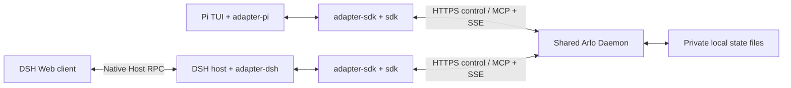

# Arlo

**Local messaging between independent agent sessions.**

[简体中文](README.zh-CN.md) · [Glossary](GLOSSARY.md) · [License](LICENSE)

Arlo lets existing Pi and DeepSeek Harness (DSH) sessions discover one another,
send context, receive messages without polling the model, and reply in their
own conversations. Sessions keep their own history and tools.

For example, ask one session to explain a change to another session and request
a review. The recipient receives the message in its existing conversation and
can send an associated reply. Arlo carries messages; each agent decides how to
act on them.

<video src="assets/arlo-cross-host-demo-v2.mp4" controls width="960"></video>

DSH Web and Pi CLI each use the native `@` menu. An existing DSH session asks
Pi to review `finalPrice`; Pi replies in that conversation. Pi then asks DSH to
check the corrected expression. Model waits are cut; the rest is real time.

**Status: public preview.** Host-version and environment records are inherited from the pre-rename implementation. The Arlo workspace passed type checking; a full post-rename regression run and native-host acceptance have not been completed.

## What it does

- Discover available root sessions in the same communication group.
- Select a recipient with native `@` contacts in Pi TUI or DSH Web.
- Receive messages proactively; busy recipients handle them at a safe later turn.
- Send associated replies and query a message's reception status.
- Start a shared local daemon on demand, with setup, diagnostics and uninstall commands.
- Pause new sending when a root session's bounded sending allowance is exhausted.

Communication stays on one machine under one OS user. By default, a Git working
tree and its worktrees share a group; independent clones remain separate. Group
membership does not grant file or tool permissions. Internal subagents are not
automatically exposed.

## Supported hosts

| Host | Version policy | Requirements |
| --- | --- | --- |
| Pi TUI | 1.1.0, 1.2.0, 1.3.0, 1.4.0 | A live, persisted native TUI root; adapter and host share their peer dependencies |
| DSH Web | 0.2.0-rc.2, 0.2.1-rc.2, 0.2.1-rc.5 | The matching complete composition: locked packages, patches and browser resources |
| Claude Code | Experimental implementation included | Separate integration; outside the Pi/DSH quick start |
| Codex | Not implemented | — |

Host version policy and environment verification are separate. A supported DSH
version alone is insufficient: an ordinary unpatched installation is not the
required composition. Pi 1.1.0 has known scheduling limitations; start with Pi
1.4.0 for this quick start.

Recorded native validation includes Linux x64 and specific Windows 10 x64
environments with Node 24.13.1. The matrix retains each combination's exact
scope and limitations; it does not establish support for every Linux distribution,
Windows build, Node release, or macOS.

```sh
node scripts/compatibility.mjs matrix --host pi --version 1.4.0
node scripts/compatibility.mjs matrix --host dsh --version 0.2.1-rc.5
```

The machine-readable policy is in
[`support-matrix.json`](docs/compatibility/support-matrix.json). Historical evidence
identifiers in the data refer to prior validation, not files bundled with this snapshot.

## Build the installation packages

This source snapshot provides local package builders. Do not assume `@arlo/*`
is available from the public npm registry. Builders obtain dependencies from npm;
they do not configure a model or invoke a paid model provider.

Use **Node 24.13.1** and **pnpm 10.26.2** for development and building:

```sh
pnpm install --frozen-lockfile --ignore-scripts
pnpm typecheck
```

Build the four Pi packages into a new directory:

```sh
pnpm run build:pi --host-version 1.4.0 --out .artifacts/pi-1.4.0 --output .artifacts/pi-1.4.0-report.json
```

This produces SDK, adapter SDK, daemon/CLI and Pi adapter tarballs, plus an isolated
consumer and installation report. Each build output directory must be unused.
Installed communication uses compiled JavaScript and does not require pnpm or
this source checkout. Your host and model configuration remain your responsibility.

### Connect an existing Pi installation

Replace `PI_PREFIX` below with the npm prefix containing the exact Pi installation
you want to use. Install all four tarballs in the same operation so their local
dependencies resolve together. Run these examples from this checkout.

```sh
npm install --prefix PI_PREFIX --ignore-scripts --legacy-peer-deps --no-audit --no-fund .artifacts/pi-1.4.0/arlo-sdk-0.1.0.tgz .artifacts/pi-1.4.0/arlo-adapter-sdk-0.1.0.tgz .artifacts/pi-1.4.0/arlo-daemon-0.1.0.tgz .artifacts/pi-1.4.0/arlo-adapter-pi-0.1.0.tgz

node PI_PREFIX/node_modules/@arlo/daemon/bin/arlo.js setup --host pi --target PI_PREFIX/node_modules/@earendil-works/pi-coding-agent --adapter PI_PREFIX/node_modules/@arlo/adapter-pi
```

The setup command previews its changes. Repeat it with `--apply` to register the
extension through Pi's native package manager, then start or reload Pi normally.
The default configuration directory is Pi's `PI_CODING_AGENT_DIR`, or `~/.pi/agent`
when unset. Add `--agent-dir PATH` if you intentionally use another configuration.
Do not register a second copy of the adapter on the same root.

### Connect DSH Web

Build a complete DSH composition using the included frozen recipe:

```sh
pnpm run build --out .artifacts/core
pnpm run build:web --host-version 0.2.1-rc.5 --core .artifacts/core --out .artifacts/dsh-rc5
```

The Web builder prepares `.artifacts/dsh-rc5/consumer` with the matching host,
Arlo packages, lock, patches and browser resources. Use that prepared host
installation with a DSH profile you have configured. Do not apply the Pi npm
installation command to this pnpm-managed composition.

Replace `DSH_HOME` and `PROFILE` with the existing DSH configuration directory
and profile you intend to use:

```sh
node .artifacts/dsh-rc5/consumer/node_modules/@arlo/daemon/bin/arlo.js setup --host dsh --target .artifacts/dsh-rc5/consumer/node_modules/@deepseek-ai/dsh --adapter .artifacts/dsh-rc5/consumer/node_modules/@arlo/adapter-dsh --dsh-home DSH_HOME --profile PROFILE
```

Review the preview, repeat with `--apply`, and start or reload that profile using
the prepared DSH installation. Setup uses the host's native profile package
manager. It does not create a profile, replace your model settings or patch an
arbitrary DSH installation. Missing composition requirements stop setup with diagnostics.

## First exchange

1. Open two native sessions in the same local Git repository or its worktrees.
   Send an ordinary message in each so its conversation is persisted.
2. For Pi↔DSH communication, submit `/arlo-settings on` in both hosts.
   Cross-host participation is off by default.
3. In the sending session, type `@`, choose the Arlo host group and then the
   exact recipient. Add a request such as “Send this session a summary of the
   change and ask for a review,” then submit.
4. The sender's model calls `arlo_send_message`. The recipient handles the input
   in its existing conversation and can reply with the original message association.

Selecting a contact only edits the draft; it does not itself send a message.
Only online, ready roots in the same group can communicate. Independent clones
do not share the default group merely because they have the same remote.

The model tools are `arlo_list_sessions`, `arlo_send_message` and
`arlo_get_message_status`. `accepted` means the target host confirmed enqueueing,
not that the model read the message or completed the requested work. `unknown`
means delivery is uncertain and must not be automatically retried.

## Controls and troubleshooting

| Native command | Purpose |
| --- | --- |
| `/arlo-settings on` / `/arlo-settings off` | Enable or disable cross-host participation |
| `/arlo-root-config` | Show this root's configuration identity, location and ownership |
| `/arlo-send-status` | Show sending mode, allowance and pause reason |
| `/arlo-continue` | Explicitly start a new bounded allowance period |
| `/arlo-reload-sending-rules` | Reload the private sending rules file |
| `/arlo-doctor` | Pi-only live host and adapter diagnostics |

The default bounded allowance is **20 dispatch attempts per root**, shared
across recipients. Ordinary chat, incoming messages and reconnects do not refill
it. A continuation starts a new full period and replaces any remaining balance.
Continuous mode can be configured; an allowance is not a token, cost or runtime limit.

To change a root's rule, obtain its `config_id` and `config_path` with
`/arlo-root-config`, edit the private file at that location, then reload it:

```json
{
  "version": 1,
  "roots": {
    "rc-00000000-0000-4000-8000-000000000001": {
      "mode": "bounded",
      "grant": 20
    }
  }
}
```

Replace the example ID with your actual root configuration ID. Use `continuous`
instead of `bounded` for continuous mode. Preserve other roots' entries and the
file's private permissions. Reloading rules does not issue a new allowance.

Using the installed CLI, `arlo status --json` and `arlo doctor --json` diagnose
the shared daemon. `arlo setup-status` accepts the same host selection arguments
as setup and checks the disk configuration. Configuration success alone does not
prove the running host has reloaded the adapter or exchanged a message. In DSH,
inspect the host's `arlo-host-loaded` output; `/arlo-doctor` is Pi-only.

## Uninstall

Run `arlo uninstall` with the same host, target, adapter and configuration
selection arguments used for setup. Review the preview, then repeat with
`--apply` and reload the host normally.

Uninstall removes the registration it owns and preserves conflicting user edits.
It leaves host history, model configuration, Arlo identity/accounting state and
other sessions intact. Packages remain installed; remove them separately through
the package manager at their original installation scope when no longer needed.

## Technical architecture

Arlo is a pnpm workspace with a shared local daemon and host-specific adapters.
The core runs on Node.js; each host keeps ownership of its sessions, model calls,
native input queue and tool permissions.

| Area | Implementation |
| --- | --- |
| Language and build | TypeScript, native ES modules and pnpm workspaces. Development pins: Node 24.13.1, pnpm 10.26.2, TypeScript 5.9.3. Installed runtime requirements are declared by each package. |
| Local transport | Node's HTTPS server and MCP Streamable HTTP, with SSE for incoming message notifications. The SDK uses `@modelcontextprotocol/client`. The daemon listens on loopback. |
| Host integration | Pi extension APIs; DSH's Cordis plugin system, native Host RPC and browser extension entry. DSH composition recipes pin the required packages, patches and resources. |
| Persistent state | Private local JSON files for discovery, root identity, authorization and sending-accounting state, with atomic writes. Arlo requires no external database or ORM. |
| Live state and caching | In-memory endpoint registries, delivery tracking and bounded receipt caches. The host retains its own conversation history and pending inputs. |
| Message scheduling | Daemon routing, admission limits and adapter reception bookkeeping feed the host's input queue. No external Redis, Kafka or other message-broker service is required. |
| Identity and authorization | Private filesystem permissions, pinned TLS identity, bootstrap credentials and root-bound tokens/leases. Communication groups limit discovery and messaging; the host continues to enforce file and tool access. |



A send goes from the host's model tool through its adapter and SDK to the daemon,
then through the recipient's SDK/adapter into the host's pending input. The host's
enqueueing confirmation returns as the reception result. A reply is a new,
associated message. This diagram shows runtime communication, not package imports.

## Code structure

| Path | Responsibility |
| --- | --- |
| [`packages/sdk/`](packages/sdk/) | Protocol types and validation, daemon discovery, authenticated clients, connection leases and communication-group resolution. |
| [`packages/adapter-sdk/`](packages/adapter-sdk/) | Shared runtime registration, reconnect/revocation lifecycle, participation and reception/receipt bookkeeping. Depends on the SDK. |
| [`packages/daemon/`](packages/daemon/) | HTTPS/MCP entry, message exchange, identity and authorization, sending allowance, rate limits, persistence, shared startup and the `arlo` CLI. Depends on the SDK. |
| [`packages/adapter-pi/`](packages/adapter-pi/) | Pi tools, native commands, contacts, session identity and input scheduling. |
| [`packages/adapter-dsh/`](packages/adapter-dsh/) | DSH host plugin (`host.mjs`), browser entry (`client.cjs`), runtime (`src/`), and composition helpers/patches (`delivery/`, `patches/`). |
| [`packages/adapter-claudecode/`](packages/adapter-claudecode/) | Experimental Claude Code Mod/sidecar integration. |
| [`scripts/`](scripts/) | Compiling and packaging the components, preparing host compositions and querying compatibility. |
| [`tests/`](tests/), [`probes/`](probes/) | Core regressions, fixtures, protocol/host probes and legacy installed-Desktop checks. |
| [`acceptance/`](acceptance/), [`pi-acceptance/`](pi-acceptance/), [`web/`](web/) | Acceptance orchestration, Pi TUI drivers, DSH Web drivers and frozen host recipes. The product's browser entry lives in `packages/adapter-dsh/client.cjs`. |
| [`delivery/`](delivery/), [`generic-delivery/`](generic-delivery/) | Installed-package consumer checks and controlled communication examples. |
| [`docs/compatibility/`](docs/compatibility/) | Machine-readable support data and resources referenced by the probes. |

For a first code walkthrough, read the [protocol](packages/sdk/src/protocol/index.ts),
the [daemon's message exchange](packages/daemon/src/message-exchange/index.ts),
the [adapter runtime](packages/adapter-sdk/src/runtime.ts), then the
[Pi entry](packages/adapter-pi/src/index.ts) or [DSH runtime](packages/adapter-dsh/src/runtime.ts).
The [CLI entry](packages/daemon/src/cli/index.ts) is the starting point for setup and diagnostics.

## Development

```sh
pnpm typecheck
pnpm test:daemon
```

Build and verify the host-independent SDK/adapter-SDK/daemon packages:

```sh
pnpm run build:generic --out .artifacts/generic
pnpm run test:generic --out .artifacts/generic
```

Host-native tests need their exact prepared host installations. Legacy installed
Desktop probes additionally need the corresponding Desktop environment; they are
not a substitute for the Pi TUI and DSH Web validation paths. Tests use controlled
local models rather than inheriting your provider credentials.

Cross-machine messaging, general offline delivery, automatic host upgrades,
cross-host session launch/history restoration, and a unified chat dashboard are
outside this preview.

## License

Arlo's original code is licensed under Apache-2.0. DSH patch context retains its
upstream MIT terms; both texts are included in [LICENSE](LICENSE). Dependencies
obtained through the package manager retain their own licenses.

Community: [LINUX DO](https://linux.do/)
