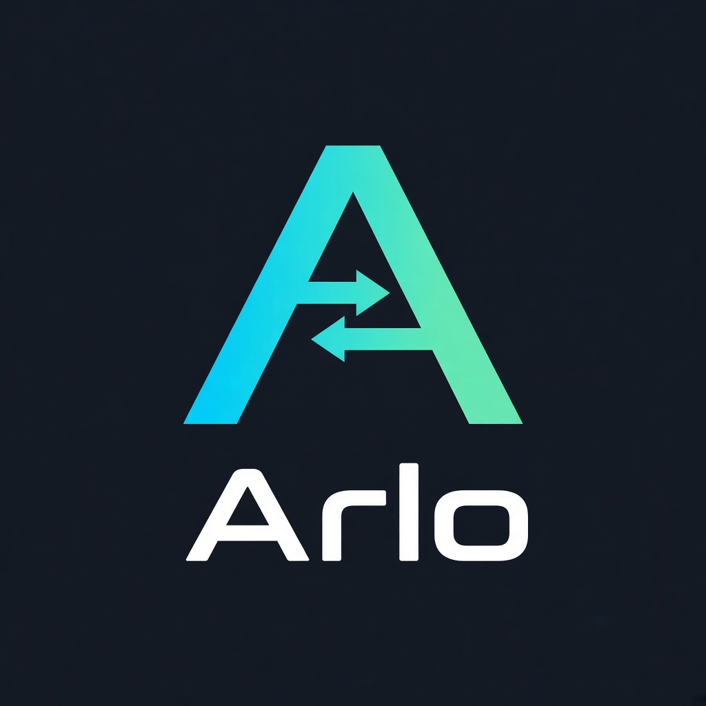
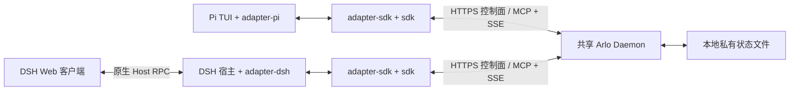

<p align="center">
  
</p>

# Arlo

**让独立 Agent 会话在本机相互通信。**

[English](README.md) · [领域术语](GLOSSARY.md) · [许可证](LICENSE)

Arlo 让已有的 Pi 与 DeepSeek Harness（DSH）会话相互发现、发送上下文、主动收信并关联回复。
每个会话继续使用自己的对话历史和工具。

例如，让一个会话把代码变更说明发送给另一个会话，请对方审查。接收方在原有对话中处理消息，
并可关联回复。Arlo 负责通信，各 Agent 自行决定如何执行消息中的请求。

https://github.com/user-attachments/assets/056d25d8-be72-45dd-b2ab-524885a5798c

DSH 网页与 Pi 命令行各自使用原生 `@` 菜单。已有的 DSH 会话请 Pi 审查 `finalPrice`，
Pi 在原对话中回复；随后 Pi 请 DSH 验算修正表达式。模型等待已剪掉，其余为实时画面。

**当前阶段：公开预览版。** 宿主版本与环境记录沿用改名前实现的历史依据。Arlo 工作区类型检查已通过，完整更名后的全部回归及原生宿主验收尚未完成。

## 功能

- 发现同一通信组内可用的根会话。
- 在 Pi TUI 或 DSH Web 的原生 `@` 菜单选择接收方。
- 主动收信；接收方忙碌时在安全的后续回合处理。
- 关联回复，并查询消息接收状态。
- 按需启动共享本地 Daemon，提供接入、诊断和卸载命令。
- 根会话的有界发信额度耗尽后，暂停新发信。

通信范围是同一台机器、同一 OS 用户。默认同一个本地 Git 仓库及其 worktree 归入同组，
独立 clone 相互隔离。加入通信组不会授予文件或工具权限，内部子 Agent 不会自动公开。

## 支持范围

| 宿主 | 版本策略 | 前提 |
| --- | --- | --- |
| Pi TUI | 1.1.0、1.2.0、1.3.0、1.4.0 | 在线、已持久化的原生 TUI 根会话；适配器与宿主共享 peer 依赖 |
| DSH Web | 0.2.0-rc.2、0.2.1-rc.2、0.2.1-rc.5 | 匹配的完整组合，包括锁定包、补丁和浏览器资源 |
| Claude Code | 源码中保留实验实现 | 独立接入方式，不在本页 Pi／DSH 快速开始范围内 |
| Codex | 尚未实现 | — |

宿主支持策略与环境验收分别判断。DSH 顶层版本号相同，不代表完整组合相同，普通未打补丁的
安装不满足该前提。Pi 1.1.0 有已知调度限制，下面的快速开始使用 Pi 1.4.0。

既有原生验收包含 Linux x64，以及特定 Windows 10 x64 环境，使用 Node 24.13.1。
每个组合的准确范围与限制由矩阵分别记录，不代表全部 Linux 发行版、Windows 构建、Node
版本或 macOS 均已验证。

```sh
node scripts/compatibility.mjs matrix --host pi --version 1.4.0
node scripts/compatibility.mjs matrix --host dsh --version 0.2.1-rc.5
```

机器可读策略见 [`support-matrix.json`](docs/compatibility/support-matrix.json)。数据中的历史证据
标识对应此前验收，不表示这些历史报告包含在本次源码快照中。

## 构建安装包

当前源码快照提供本地构建入口，不应假设公共 npm 已有 `@arlo/*`。
构建器会从 npm 获取依赖，不配置模型，也不调用付费模型供应商。

开发和构建使用 **Node 24.13.1**、**pnpm 10.26.2**：

```sh
pnpm install --frozen-lockfile --ignore-scripts
pnpm typecheck
```

把 Pi 的四个编译包输出到一个新目录：

```sh
pnpm run build:pi --host-version 1.4.0 --out .artifacts/pi-1.4.0 --output .artifacts/pi-1.4.0-report.json
```

输出包含 SDK、适配 SDK、Daemon／CLI、Pi 适配器四个 tarball，以及独立 consumer 和安装报告。
每次构建必须使用尚不存在的输出目录。安装后的通信使用编译 JavaScript，不依赖 pnpm 或源码
checkout；宿主及模型仍由用户自行安装配置。

### 接入已有 Pi

将下面的 `PI_PREFIX` 替换为准确目标 Pi 所在的 npm prefix。四个 tarball 需要在同一次操作中
安装，确保本地组件依赖一起解析。以下命令在本源码目录执行。

```sh
npm install --prefix PI_PREFIX --ignore-scripts --legacy-peer-deps --no-audit --no-fund .artifacts/pi-1.4.0/arlo-sdk-0.1.0.tgz .artifacts/pi-1.4.0/arlo-adapter-sdk-0.1.0.tgz .artifacts/pi-1.4.0/arlo-daemon-0.1.0.tgz .artifacts/pi-1.4.0/arlo-adapter-pi-0.1.0.tgz

node PI_PREFIX/node_modules/@arlo/daemon/bin/arlo.js setup --host pi --target PI_PREFIX/node_modules/@earendil-works/pi-coding-agent --adapter PI_PREFIX/node_modules/@arlo/adapter-pi
```

`setup` 默认展示变更预览，确认后在同一命令末尾增加 `--apply`，通过 Pi 原生包管理器登记扩展。
随后正常启动或重载 Pi。默认用户配置目录取 `PI_CODING_AGENT_DIR`，未设置时为 `~/.pi/agent`；
有意使用另一份配置时增加 `--agent-dir PATH`。同一个根会话只保留一条适配器加载路径。

### 接入 DSH Web

编译版 CLI 可以自动准备正常已有的 DSH 0.2.1-rc.5 本地安装，其归属须由本地 npm 锁或
标准隔离布局的 pnpm 记录核实。选择准确安装和一份现有 profile，核对具体修补、组件和
原生登记计划后确认；原有启动入口、模型设置和历史保留。直接命令、实验组合选择及
支持的安装边界见 [DSH 接入与恢复](packages/daemon/setup-dsh/README.md)。

维护者也可以使用已有冻结配方构建完整组合：

```sh
pnpm run build --out .artifacts/core
pnpm run build:web --host-version 0.2.1-rc.5 --core .artifacts/core --out .artifacts/dsh-rc5
```

Web 构建器会在 `.artifacts/dsh-rc5/consumer` 准备匹配的宿主、Arlo 包、锁、补丁和浏览器资源。
使用这份已准备的宿主安装，配合你已配置好的 DSH profile。不要把 Pi 的 npm 安装命令套用到
这份 pnpm 管理的完整组合。

将 `DSH_HOME`、`PROFILE` 替换为要接入的现有 DSH 配置目录和 profile：

```sh
node .artifacts/dsh-rc5/consumer/node_modules/@arlo/daemon/bin/arlo.js setup --host dsh --target .artifacts/dsh-rc5/consumer/node_modules/@deepseek-ai/dsh --adapter .artifacts/dsh-rc5/consumer/node_modules/@arlo/adapter-dsh --dsh-home DSH_HOME --profile PROFILE
```

核对预览，在同一命令末尾增加 `--apply`，再通过已准备的 DSH 安装正常启动或重载该 profile。
接入复用宿主原生 profile 包管理器，保留现有模型设置和历史；这条已准备宿主的路径在
完整组合缺项时会停止并给出诊断。

## 第一次通信

1. 在同一本地 Git 仓库或其 worktree 中打开两个原生会话，各发送一次普通消息，让对话持久化。
2. 如需 Pi↔DSH 通信，在两端分别提交 `/arlo-settings on`。跨宿主参与默认关闭。
3. 在发送方输入 `@`，进入 Arlo 宿主分组，选择准确的接收会话，再写上“把这次变更说明发送
   给这个会话，请对方审查”等明确请求并提交。
4. 发送方模型调用 `arlo_send_message`，接收方在已有对话中处理，可关联原消息回复。

选择联系人只编辑草稿，不会立即发送。只有在线、就绪且同组的根会话可以通信；两个独立 clone
不会仅因 remote 相同就自动归入同组。

模型工具为 `arlo_list_sessions`、`arlo_send_message`、`arlo_get_message_status`。
`accepted` 表示目标宿主确认入队，不表示模型已读或任务完成；`unknown` 表示投递未决，不能
自动当成失败重发。

## 控制与排查

| 原生命令 | 用途 |
| --- | --- |
| `/arlo-settings on`／`/arlo-settings off` | 开关跨宿主参与 |
| `/arlo-root-config` | 查询当前根的配置标识、位置与归属 |
| `/arlo-send-status` | 查询模式、额度与暂停原因 |
| `/arlo-continue` | 真人明确开启新的有界额度周期 |
| `/arlo-reload-sending-rules` | 重载私有发信规则文件 |
| `/arlo-doctor` | 仅 Pi：检查实际宿主与适配器 |

默认每根会话采用有界模式，额度为 **20 次派发尝试**，所有接收方共享。普通聊天、收信和重连
不会补额；继续操作开启一个完整新周期，替换原有剩余额度。也可配置持续模式。发信额度不能
视为 Token、费用或运行时间上限。

需要修改规则时，通过 `/arlo-root-config` 获取当前根的 `config_id` 与 `config_path`，在返回的
私有文件位置编辑规则，再提交重载命令：

```json
{
  "version": 1,
  "roots": {
    "rc-00000000-0000-4000-8000-000000000001": {
      "mode": "bounded",
      "grant": 20
    }
  }
}
```

把示例标识替换为实际根配置标识；持续模式使用 `continuous`。保留其他根的配置项及文件的私有
权限。重载只应用规则，不会发放新的额度。

安装后的 CLI 可用 `arlo status --json`、`arlo doctor --json` 诊断共享 Daemon。
`arlo setup-status` 接受与 setup 相同的宿主选择参数，检查磁盘配置。配置成功不等于运行中的
宿主已经重载或完成通信；DSH 应查看 Host 的 `arlo-host-loaded` 输出，`/arlo-doctor` 仅供 Pi。

## 卸载

使用 `arlo uninstall`，传入与 setup 相同的宿主、目标、适配器及用户配置选择参数。
先核对预览，再加 `--apply`，最后正常重载宿主。

卸载只撤销本次自有登记，遇到用户后续修改时保留并报告冲突。宿主历史、模型配置、Arlo 身份
与计账状态、其他会话均保留。组件包仍存在，确认没有其他接入依赖后，通过原安装范围的包
管理器另行移除。

## 技术架构

Arlo 采用 pnpm workspace，将共享本地 Daemon 与各宿主适配器分开。核心运行在 Node.js 上；
会话、模型调用、原生输入队列及工具权限由各宿主管理。

| 方面 | 实现 |
| --- | --- |
| 语言与构建 | TypeScript、原生 ES Modules、pnpm workspaces。开发固定 Node 24.13.1、pnpm 10.26.2、TypeScript 5.9.3；安装包的运行要求由各包分别声明。 |
| 本机传输 | Node 内置 HTTPS 服务与 MCP Streamable HTTP，入站消息通过 SSE 通知。SDK 使用 `@modelcontextprotocol/client`；Daemon 监听本机 loopback。 |
| 宿主接入 | Pi 扩展 API；DSH 的 Cordis 插件体系、原生 Host RPC 与浏览器扩展入口。DSH 完整组合配方固定依赖、补丁和资源。 |
| 持久化 | 发现记录、根身份、授权及发信计账状态保存到用户私有的本地 JSON 文件，通过原子写入更新。Arlo 无需外部数据库或 ORM。 |
| 活跃状态与缓存 | 内存中的端点登记、投递跟踪和有界回执缓存；原生对话历史及待处理输入仍由宿主持有。 |
| 消息调度 | Daemon 路由与准入限制、适配层收信记账共同衔接宿主输入队列，无需 Redis、Kafka 等外部消息中间件。 |
| 身份与权限 | 私有文件权限、固定验证的 TLS 身份、引导凭据及绑定根会话的 token／租约。通信组限制发现与通信范围，文件及工具访问继续由宿主控制。 |



一次发送从宿主中的模型工具出发，经适配器和 SDK 到达 Daemon，再经接收方 SDK／适配器进入
宿主待处理输入。宿主确认入队后返回接收结果；关联回复是一条新消息。图中箭头表示运行时
通信，模块导入依赖则由下面的职责划分说明。

## 代码结构

| 路径 | 职责 |
| --- | --- |
| [`packages/sdk/`](packages/sdk/) | 协议类型与校验、Daemon 发现、认证客户端、连接租约和通信组解析。 |
| [`packages/adapter-sdk/`](packages/adapter-sdk/) | 共享的运行时登记、重连与撤销生命周期、参与开关，以及收信和回执记账；依赖 SDK。 |
| [`packages/daemon/`](packages/daemon/) | HTTPS／MCP 入口、消息交换、身份与授权、发信额度、限流、持久化、共享启动及 `arlo` CLI；依赖 SDK。 |
| [`packages/adapter-pi/`](packages/adapter-pi/) | Pi 工具、原生命令、联系人、会话身份和输入调度。 |
| [`packages/adapter-dsh/`](packages/adapter-dsh/) | DSH 宿主插件 `host.mjs`、浏览器入口 `client.cjs`、`src/` 运行时，以及 `delivery/`、`patches/` 中的组合辅助与补丁。 |
| [`packages/adapter-claudecode/`](packages/adapter-claudecode/) | 实验性的 Claude Code Mod／sidecar 接入。 |
| [`scripts/`](scripts/) | 编译打包、宿主组合准备和兼容性查询。 |
| [`tests/`](tests/)、[`probes/`](probes/) | 核心回归、fixtures、协议与宿主探针，以及旧版已安装 Desktop 检查。 |
| [`acceptance/`](acceptance/)、[`pi-acceptance/`](pi-acceptance/)、[`web/`](web/) | 验收编排、Pi TUI 驱动、DSH Web 驱动和冻结宿主配方；产品浏览器入口位于 `packages/adapter-dsh/client.cjs`。 |
| [`delivery/`](delivery/)、[`generic-delivery/`](generic-delivery/) | 编译安装包的 consumer 检查与受控通信示例。 |
| [`docs/compatibility/`](docs/compatibility/) | 机器可读支持数据与探针引用的资源。 |

第一次读代码，可以依次看[协议](packages/sdk/src/protocol/index.ts)、
[Daemon 消息交换](packages/daemon/src/message-exchange/index.ts)、
[适配层运行时](packages/adapter-sdk/src/runtime.ts)，再看
[Pi 入口](packages/adapter-pi/src/index.ts)或 [DSH 运行时](packages/adapter-dsh/src/runtime.ts)。
安装与诊断从 [CLI 入口](packages/daemon/src/cli/index.ts)开始。

## 开发

```sh
pnpm typecheck
pnpm test:daemon
```

独立构建、验证不依赖宿主的 SDK／适配 SDK／Daemon：

```sh
pnpm run build:generic --out .artifacts/generic
pnpm run test:generic --out .artifacts/generic
```

原生验收需要准确的已准备宿主安装。旧版已安装 Desktop 探针另需对应 Desktop 环境，不能代替
Pi TUI 和 DSH Web 的验收路径。测试使用受控本地模型，不继承你的供应商凭据。

跨机器通信、通用离线补投、自动宿主升级、跨宿主启动／历史恢复、统一聊天看板不在本预览范围内。

## 许可证

Arlo 新实现采用 Apache-2.0；DSH 补丁中的上游上下文保留原 MIT 条款，两份文本均收录于
[LICENSE](LICENSE)。由包管理器获取的依赖保留各自许可证。

社区：[LINUX DO](https://linux.do/)
